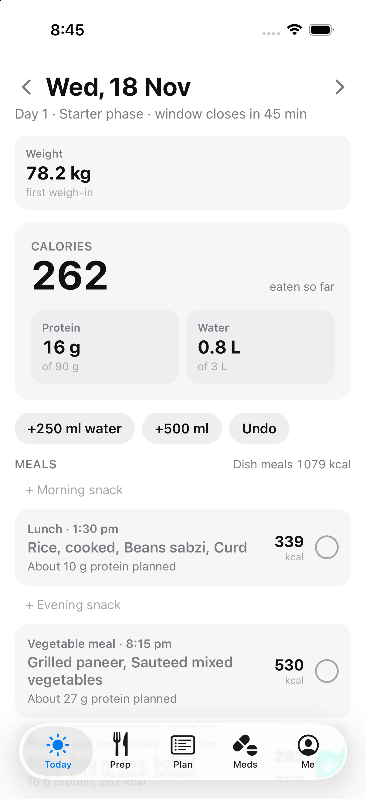
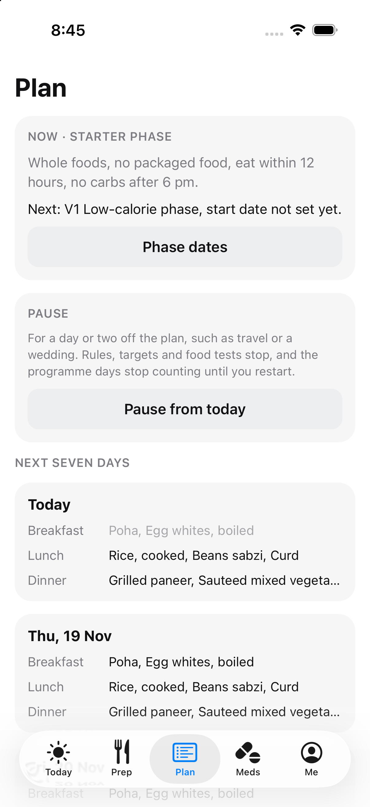
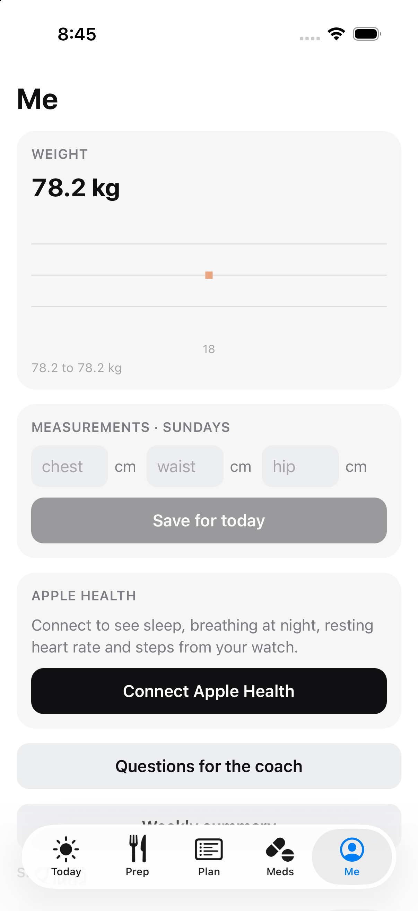

# Healthy Me

An iPhone app for following a structured eating plan: log meals, water and weight, keep track of supplements, and see how each meal changes the rest of the day. Everything stays on the phone.

Built with Expo and React Native, using SQLite for local storage.

| Today | Plan | Me |
|---|---|---|
|  |  |  |

The screenshots use invented demo data from the iOS Simulator.

## What it does

- **Today.** Weight, calories, protein and water against daily targets. Each meal is one card you tick when eaten.
- **Plan.** Phases with their own rules, a pause option, and a seven-day view of planned meals.
- **Prep.** A shopping and cooking-prep view built from the plan.
- **Meds.** Supplement reminders with times, doses and plain-words notes.
- **Meal builder.** Pick or build a meal and see what it does to the day, with suggestions for the meals still to come.
- **Food rules.** Each food is checked against the current phase as you add it: allowed, not yet, ask, or new.
- **Voice, photo and barcode logging.** Say what you ate, photograph a plate or label, or scan a barcode.
- **Siri, widgets and notifications.** Log water or weight by voice, a home screen widget, and alarms for meals and doses.
- **Apple Health.** Optional read of sleep, resting heart rate and steps, and write of water and weight.

## How it is built

| Area | Where |
|---|---|
| Screens (expo-router) | `src/app/` |
| Logic: plan, rules, meals, alarms, search | `src/lib/` |
| Shared UI and charts (Skia) | `src/components/` |
| Siri intents and widget (Swift) | `targets/` |
| Photo reading server (Python, open-source vision model on Modal) | `vision-server/` |
| Sample plan and recipes | `plan/`, `src/data/` |
| Tests | `test/` |

## Run it

```bash
npm install
npm test          # node tests
npm run typecheck
npm run ios       # builds and runs in the iOS Simulator
```

Photo reading needs your own vision server and `EXPO_PUBLIC_VISION_KEY` in `.env.local`. Without it the app works with typed and voice logging.

## About the data

The plan, recipes and supplements in this repository are invented samples. The app ships without any medicine brand database, so brand search returns nothing until you add one.
